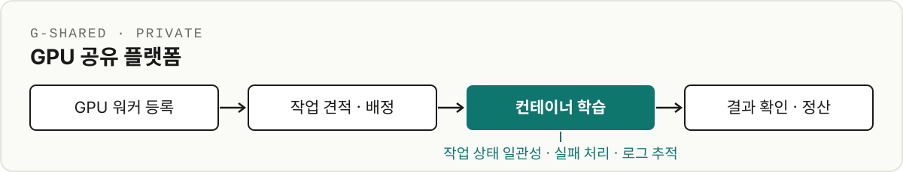
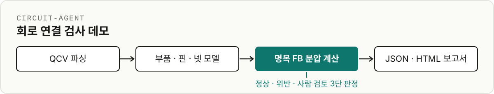
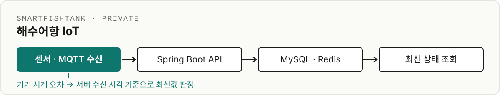
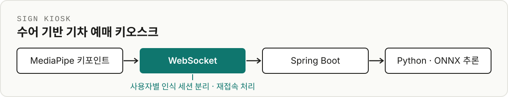
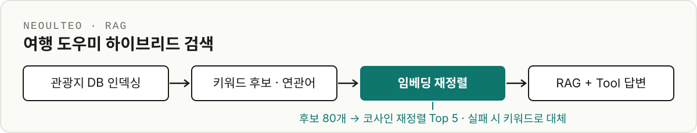

<h1 align="center">안녕하세요, doukdoll입니다 👋</h1>

  <strong>작업이 왜 실패했는지, 다음 사람이 로그만 보고 다시 따라갈 수 있게 만듭니다.</strong> 
  Java · Spring Boot · WebSocket · Docker로 백엔드 API, 실시간 통신, 실행 환경과 운영 로그를 다룹니다.

---

## ✨ 만들고 기록하는 것

화면에 보이는 기능 뒤에서 데이터가 어떻게 흐르고, 작업이 어떻게 끝나는지 살피는 일을 좋아합니다.
문제가 생기면 로그와 재현 가능한 사례에서 원인을 찾고, 다음 사람이 다시 따라갈 수 있도록 남깁니다.
흐름도의 청록색 칸이 제가 직접 다룬 단계이고, 비공개 프로젝트는 코드 대신 맡은 문제와 해결 과정을 적었습니다.

### 🖥️ G-Shared 비공개 프로젝트

> 쉬고 있는 GPU와 AI 연산이 필요한 사용자를 연결하는 GPU 공유 플랫폼

- **작업의 흐름** · GPU 워커 등록 → 작업 견적·배정 → 컨테이너 학습 → 결과 확인·정산
- **살펴본 문제** · 작업 상태와 실행 결과의 일관성, 실패 처리, 여러 서비스에 흩어진 로그 추적

`Java` · `Spring Boot` · `Python` · `WebSocket` · `Docker` · `Grafana / Loki / Alloy`

 

### 🔎 [circuit-agent](https://github.com/doukdoll/circuit-agent)

> 회로의 연결을 읽고, 계산 결과와 판단 근거를 함께 보여주는 검사 데모

- **만든 흐름** · QCV 파싱 → 부품·핀·넷 모델 구성 → 명목 FB 분압 계산 → JSON·HTML 보고서
- **판정의 기준** · 정상·위반·사람 검토를 구분하고, 값 누락이나 모호한 연결은 검토 대상으로 처리
- **검증 기록** · 공개 샘플과 기대 결과를 분리하고, 줄바꿈 차이까지 포함한 테스트 38개 통과 기록

`Java 21` · `Maven` · `JUnit`

[개발·실행 가이드 ↗](https://github.com/doukdoll/circuit-agent/blob/main/docs/DEVELOPMENT_GUIDE.md) · [샘플과 기대 결과 ↗](https://github.com/doukdoll/circuit-agent/blob/main/samples/README.md)

 

### 🐠 SmartFishTank 비공개 프로젝트

> 해수어항의 센서 데이터를 모으고 상태를 살피는 IoT 프로젝트 · 백엔드·인프라

- **데이터 연결** · MQTT 기기 데이터 수집, Spring Boot API, MySQL·Redis 기반 데이터 처리
- **해결한 문제** · 기기 시계 오차로 오래된 값이 최신으로 선택되던 오류를 서버 수신 시각 기준으로 수정
- **함께 남긴 것** · Docker Compose 실행 방법, 환경변수 차이, MQTT 연결과 배포 트러블슈팅

`Java` · `Spring Boot` · `MySQL` · `Redis` · `MQTT` · `Docker Compose`

 

### 🚆 [수어 기반 기차 예매 키오스크](https://github.com/doukdoll/sign_language_ver.2)

> 웹캠의 수어 입력으로 역을 선택하고 열차를 조회하는 키오스크 프로토타입

- **연결한 흐름** · MediaPipe 키포인트 → WebSocket → Spring Boot → Python·ONNX 추론
- **다듬은 부분** · 사용자별 인식 세션 분리, 재접속·초기화, 카메라 종료와 예약 상태 처리
- **검증 기록** · FE·BE·AI 회귀 테스트와 GitHub Actions CI 구성, 실제 ONNX 연동은 별도 합성 입력으로 확인

`React` · `TypeScript` · `Spring Boot` · `WebSocket` · `Python` · `ONNX Runtime`

[연동 검증 기록 ↗](https://github.com/doukdoll/sign_language_ver.2/blob/main/docs/LIVE_RECOGNITION_CHECK.md) · [자동 검증 범위 ↗](https://github.com/doukdoll/sign_language_ver.2/blob/main/docs/CI.md)

 

### 🧭 [Neoulteo](https://github.com/doukdoll/Neoulteo)

> 공공 관광 데이터와 지도로 여행지를 찾고 일자별 코스를 만드는 여행 플랫폼 · RAG 여행 도우미 담당

- **검색 흐름** · 관광지 DB 인덱싱 → 키워드 후보 80개·연관어 확장 → 임베딩 코사인 재정렬 Top 5 → RAG + Tool 결합 답변
- **실패 대비** · 임베딩 모델이 없거나 호출이 실패하면 키워드 점수만으로 결과를 돌려주고, LLM이 꺼져 있어도 대체 답변 제공
- **문서 RAG** · FastAPI에서 PDF·TXT·MD를 1000자 청크(100자 겹침)로 나눠 ChromaDB에 저장, 유사도 0.20 미만은 버리고 출처를 붙여 답변

`Spring AI` · `Spring Boot` · `FastAPI` · `sentence-transformers` · `ChromaDB` · `Vue 3`

---

  작동하는 코드와 함께, 선택한 이유와 해결 과정을 남깁니다. 
  Contact · doukdoll75@naver.com 
  Updated · 2026.11

